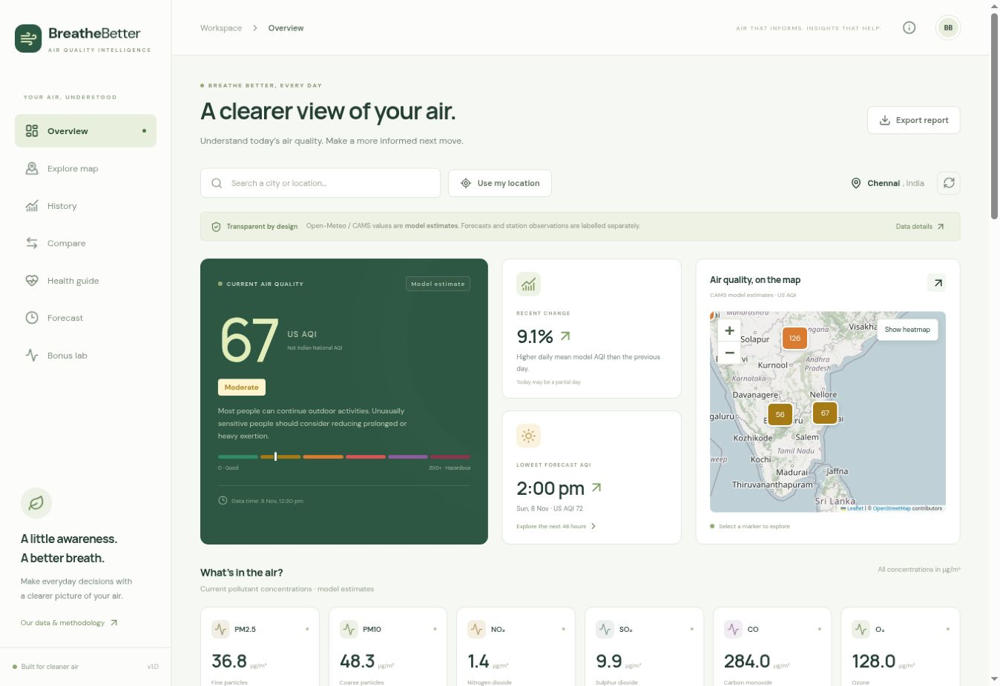
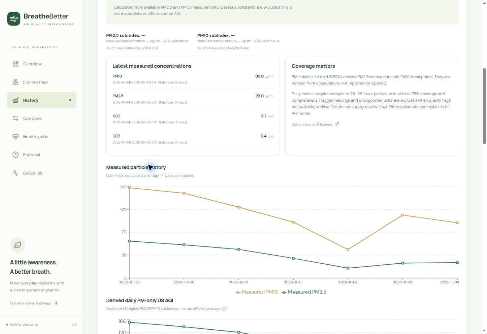
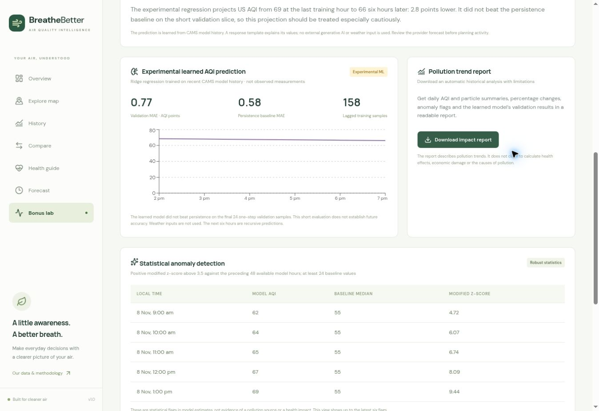

# Breathe Better

Air quality intelligence and an outdoor-time planner built for the Lets Code Diwali Challenge 2026.

## What works

- Responsive dashboard with current CAMS model US AQI, category, six pollutant concentrations and timestamps.
- Worldwide place search and optional browser geolocation.
- Interactive OpenStreetMap map with colour-coded model AQI markers, zoom, pan and point selection.
- Recent model history with AQI, PM2.5 and PM10 charts; date comparisons; percentage changes; transparent spike detection.
- Comparison of up to four Indian cities, pollutant differences and historical trends.
- General health guidance, sensitive-group context and US AQI category explanations.
- 48-hour forecast, lowest-AQI hours and potential spike flags.
- Relatively cleaner city ranking, downloadable JSON reports and persistent in-app threshold alerts.
- Server-side OpenAQ v3 integration for nearby physical station observations, derived PM-only NowCast AQI, and up to 30 days of measured particle history (requires your key).
- AccuWeather current conditions (temperature, RealFeel™, humidity, wind/gusts, UV, cloud cover, visibility and pressure) and a one-day weather forecast (requires your AccuWeather API key).

## Important competition gaps

This is a working first version, not a claim of a completed eligible submission.

1. Current OpenAQ API access still needs `OPENAQ_API_KEY`. A key-free alternative now loads delayed observed measurements and up to eight published days from the official OpenAQ AWS archive for two Chennai stations (Arumbakkam and Manali Village). The archive is written at least 72 hours after the end of the source day, never presented as live data. Source quality flags are not in the CSVs. Derived daily PM subindices require at least 18 adequately sampled hourly bins; hourly completeness is conservatively inferred from the timestamp cadence. Broader/current station coverage needs a key. Verify local station coverage. OpenAQ integration and PM-only AQI/history are implemented but have not been live-tested with a real credential. The model dashboard is **not an observed real-time AQI feed**. The station panel separately derives PM-only US AQI; it excludes gases and is not an official complete station AQI. Confirm this scope meets the organiser’s requirements.
2. Add `ACCUWEATHER_API_KEY` and verify your subscription grants geoposition, current conditions with details, and one-day forecast with details. Missing or rejected credentials have explicit empty/error states. No other weather service is substituted.
3. Source is published at https://github.com/mm3552/breathe-better. and the public application is available at https://breathe-better-air-intelligence.afootkrill4.chatgpt.site/ (verified without sign-in).
4. A 2 minute 36 second captioned walkthrough made from actual public-app captures is included at [Demo video](docs/Breathe_Better_Captioned_Demo.mp4). It has no narration and is not a continuous screen recording.
5. Verify the submission form and deadline timezone with the organiser.

## Stack

React 19, TypeScript, Vinext (Next.js-compatible App Router), Vite, Cloudflare Workers, Recharts, Leaflet, Lucide icons and custom responsive CSS. No database or paid AI service is required.

## Run locally

Requires Node.js 22.13+ and pnpm (see `packageManager` in package.json).

```sh
corepack enable
pnpm install
cp .env.example .env.local
pnpm dev
```

Use the URL printed by the development server. For local provider secrets use an ignored `.dev.vars` file if required by your Cloudflare/Vinext environment. Production secrets must be configured with your hosting provider; never put keys in frontend variables or Git.

```sh
pnpm exec tsc --noEmit
node --experimental-strip-types --test tests/*.test.mjs
pnpm build
```

The repository retains Sites runtime helpers. In this managed workspace, use the supplied Sites installer/build helpers instead of running a second package-manager installation. Cloudflare production output is `dist/server/index.js` plus client assets under `dist/client`.

## APIs and attribution

- [Open-Meteo Air Quality API](https://open-meteo.com/en/docs/air-quality-api): current and historical model data and forecasts from CAMS / ECMWF. All six concentrations are requested in μg/m³, including CO. Provider `us_aqi` is used directly; this app does not relabel it as Indian National AQI. CAMS data via Open-Meteo is credited in the interface.
- [Open-Meteo Geocoding](https://open-meteo.com/en/docs/geocoding-api): place search.
- [AccuWeather](https://developer.accuweather.com/): current weather conditions and one-day forecasts. Use `ACCUWEATHER_API_KEY` as a server-only bearer token, following current provider authentication documentation. Geoposition resolutions cache for 24 hours, current conditions 30 minutes and daily forecasts 3 hours to reduce quota use. Subscription limits still apply. AccuWeather is a weather source here, not the pollution measurement source.
- [OpenAQ v3](https://docs.openaq.org/): observed station concentrations. Obtain a free account and key from OpenAQ. Set `OPENAQ_API_KEY` server-side. The integration lists up to 20 locations within 25 km and fetches the latest data for up to five recently reporting stations. Each station credits its originating provider and links to source/licence information. Coverage is not guaranteed.
- [OpenStreetMap](https://www.openstreetmap.org/copyright): map tiles and attribution. Follow the standard tile usage policy; do not bulk-download tiles.
- [AirNow](https://www.airnow.gov/aqi/aqi-basics/) and [US EPA](https://www.epa.gov/pm-pollution/health-and-environmental-effects-particulate-matter-pm): category and particulate-health context.

Check all provider usage terms before a public launch. No fabricated or hardcoded pollution values are used. City coordinates are configuration, not environmental measurements.

## Methodology

- **Current model estimate:** Open-Meteo current valid time, not a station reading.
- **History:** available hourly model values, grouped by local calendar date, averaged to daily trend summaries. Daily mean AQI is not an official daily reported AQI. Today can be partial; available hour counts are shown. Missing values remain null.
- **Forecast:** future hours only, next 48 hours. The lowest available model AQI ranks candidate hours; it does not guarantee safe conditions.
- **US AQI categories:** 0–50 Good, 51–100 Moderate, 101–150 Unhealthy for sensitive groups, 151–200 Unhealthy, 201–300 Very unhealthy, 301+ Hazardous.
- **Change:** `(new - old) / old * 100`; unavailable for zero/missing baselines.
- **Spike:** at least a 25% rise from the preceding available day or preceding forecast hour. A rule-based flag, not ML or causal inference.
- **Map precision:** CAMS global model resolution is about 45 km. Markers indicate requested locations; nearby locations may share one model grid cell. Not street-level monitoring.
- **Stations:** individual physical concentrations with their own timestamp/units. Data older than three hours is marked stale. No instantaneous conversion to AQI.
- **Derived current PM-only AQI:** use the US EPA PM NowCast (12 hourly slots, minimum two valid slots among the latest three, weight factor max(0.5, min/max)). PM concentrations truncate to one decimal place for PM2.5 and an integer for PM10 before interpolation. The maximum eligible PM subindex is labelled PM-only and is not an official complete station AQI. Revised 2024 PM2.5 breakpoints were verified against US EPA May 2026 guidance. Values beyond 500 extend the final segment slope.
- **Observed history:** OpenAQ daily aggregates from the selected station’s PM sensors; maximum 30 displayed calendar days. Completed daily periods must span 23–25 hours, end in the past and meet 75% coverage and completeness for a derived daily subindex. Flagged or unsupported-unit readings are excluded from indices. Gaps in dates are inserted as nulls. Incomplete concentration means are labelled with coverage, with no daily AQI assigned. Change/spike flags require consecutive calendar dates.
- **EPA methodology source:** https://document.airnow.gov/technical-assistance-document-for-the-reporting-of-daily-air-quailty.pdf and https://aqs.epa.gov/aqsweb/documents/codetables/aqi_breakpoints.html
- **Alerts:** evaluated on fetched model data only, while the page is open. No background push or email. Auto-refresh is every ten minutes. A threshold of 100 triggers at AQI >= 100.
- **Caching:** bounded per-isolate ten-minute upstream cache (search one hour); not a durable historical store. Errors do not substitute sample data. API failures, missing station configuration and rate limits have explicit UI states.

## Security

Secrets are server-only. The APIs validate coordinate ranges and length-limit search queries. Upstream URLs are fixed to providers, not user-controlled hosts. Requests have timeouts and bounded caching. Public launch should add provider-appropriate edge rate limiting and usage monitoring. Avoid logging keys or precise user coordinates. Geolocation is opt-in through browser permission.

## Suggested demo (2–3 minutes)

- 0:00–0:20: Explain the outdoor-planning problem and distinguish models from observations.
- 0:20–0:45: Search Chennai, inspect AQI and pollutants, source and data time.
- 0:45–1:05: Explore the map and select a different place.
- 1:05–1:30: Show historical trends, date comparisons and spike flags.
- 1:30–1:50: Compare cities and show relatively cleaner locations.
- 1:50–2:15: Open forecast and identify the lowest predicted AQI hours.
- 2:15–2:40: Show category guidance, in-app alerts and report export.
- 2:40–3:00: Show connected station data, provider credits and clearly state remaining limits.

Do not claim station or AccuWeather features are live until real keys and actual coverage/entitlements have been tested. The source includes tested calculations; that is distinct from end-to-end provider verification.

## Publication checklist

- [x] GitHub connection authenticated as `mm3552`.
- [x] Public `breathe-better.` repository created and populated.
- [ ] `OPENAQ_API_KEY` configured as a server secret; real station data verified.
- [ ] `ACCUWEATHER_API_KEY` configured as a server secret; current/daily endpoints verified.
- [x] Public application access approved and verified without sign-in.
- [x] Screenshots and a 2:36 captioned walkthrough captured from the verified application.
- [ ] Final form submitted by the participant.

The script above is a suggested live presentation. The included captioned video uses real app screenshots, not a continuous recording.


## Bonus Lab additions

| Bonus | Implementation and scope |
|---|---|
| AI AQI assistant | Local multinomial Naive Bayes intent classifier trained on a small, visible phrase corpus. Answers use bounded templates grounded in the current model data. Not an LLM and not an arbitrary-question chatbot. |
| Smart alerts | Foreground in-app thresholds saved in localStorage; no background push/email. |
| ML-based prediction | Six recursive hours from ridge regression over recent CAMS model AQI history. Lag-1, lag-24 and local-hour sine/cosine features. Chronological final-24-sample one-step validation reports MAE against persistence. At least 72 usable samples required. No weather features and no claim of operational skill. |
| Pollution heatmap | Toggleable translucent smoothing overlay around sparse model locations. Colours between points are not measured AQI; the view explicitly explains this. |
| Location-based AQI | Opt-in browser geolocation and global location search. |
| Clean air finder | Ranks relatively lower model AQI among the loaded Indian cities. No guarantee of safe air. |
| Sharing cards | Canvas-generated 1200×630 PNG with model/US scale labels, source and time; Web Share API where supported; text-copy fallback. |
| Pollution impact report | Downloadable text trend report: daily means, change, anomalies and model validation. Does not estimate causal, health or economic impact. |
| Leaderboard | Colour-coded current model AQI ranking among loaded cities. |
| Voice assistant | Optional browser SpeechRecognition and speech synthesis for the bounded assistant. Requires browser support and explicit microphone permission; browser speech services may process audio. |
| Anomaly detection | Positive modified z-score >3.5 against up to 48 preceding model hours, with at least 24 baseline values. Zero-MAD baseline returns no score. Distinct from the existing 25% spike rule. |
| Multi-API integration | Open-Meteo AQI + geocoding, OpenAQ public S3 archive and OSM tiles; credentialed OpenAQ/AccuWeather remain optional pending setup. |
| AI-generated insights | Implemented as an ML-derived trend insight: a bounded template explains the learned regression’s predicted AQI change and validation outcome. This is a local AI-derived summary, not LLM-written analysis and not an external generative AI service. |

### Archive sources

- https://docs.openaq.org/aws/about — official layout and the 72-hour publishing delay.
- https://registry.opendata.aws/openaq/ — public unauthenticated archive access.
- https://explore.openaq.org/locations/11581 — Arumbakkam, Chennai (CPCB/TNPCB).
- https://explore.openaq.org/locations/10780 — Manali Village, Chennai (CPCB/TNPCB).

The archive catalogue IDs are configuration and are not hardcoded pollution values. All environmental values are fetched from official published files. Requests are fixed to the official host, cached, time-limited and bounded in size. Missing and incomplete data remain missing. Public model values, experimental predictions, archived observations and current station observations remain separate.

## Public demo and screenshots

[Open the application](https://breathe-better-air-intelligence.afootkrill4.chatgpt.site/)

[Watch or download the 2:36 captioned demo](docs/Breathe_Better_Captioned_Demo.mp4)






