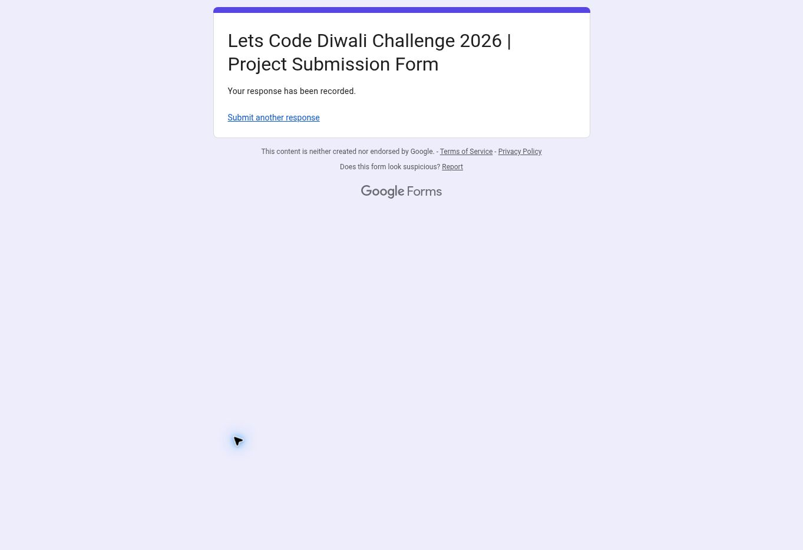

# Submission recorded

Submitted through the organiser's Google Form on 8 November 2026. The confirmation page displayed: "Your response has been recorded."

The submission includes the public app, GitHub repository and 2:36 captioned demo. It discloses that the main AQI feed is a model estimate, OpenAQ archive observations are delayed, and current OpenAQ/AccuWeather integrations await credentials. Recording a response does not establish organiser acceptance or eligibility.
